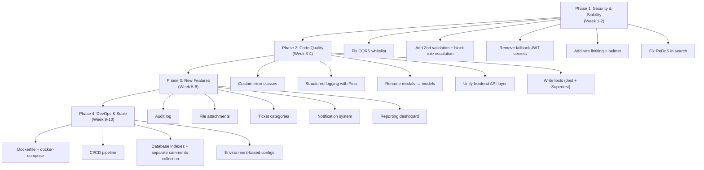

# Customer Care Portal — Honest Production-Grade Evaluation

> Evaluated as a 15+ year senior engineer would evaluate a codebase before deciding to ship it to production at scale.

---

## Part 1: Rating — 32/100

That number isn't meant to discourage you. It means **you've built a working MVP with good foundational instincts**, but there's a canyon between "working on localhost" and "serving 10K+ agents handling 500K tickets/day at a Jio, Airtel, or Infosys contact center." Let me break down exactly where the 32 comes from.

### Scorecard Breakdown

| Category | Max | Your Score | Notes |
|---|---|---|---|
| **Architecture & Separation of Concerns** | 15 | 7 | Service layer exists (good!), but no proper error classes, no DTO layer, no validation library, mixed concerns in `user.controller.js` |
| **Authentication & Security** | 15 | 7 | JWT refresh rotation is solid, but fallback secrets in code, no rate limiting, no CSRF, no helmet, CORS wide open, tokens in localStorage |
| **Code Quality & Consistency** | 10 | 4 | Inconsistent formatting (CRLF vs LF mixed), `modals/` should be `models/`, `throw new Error()` everywhere instead of typed errors, some files use `apiClient`, auth files use raw `fetch` |
| **Input Validation & Sanitization** | 10 | 3 | Hand-rolled validation only for customer. No Joi/Zod/Yup. No request body sanitization. Search uses raw `new RegExp(userInput)` — **ReDoS vulnerability** |
| **Error Handling** | 10 | 3 | No custom error classes. Generic `throw new Error()` everywhere. Error middleware defaults to 400 for everything including server crashes. No structured error codes for frontend |
| **Testing** | 10 | 0 | Zero tests. No unit tests, no integration tests, no E2E tests. This alone would block any production deployment at an MNC |
| **Observability (Logging, Monitoring)** | 5 | 0 | Only `console.log` / `console.error`. No structured logging (Winston/Pino). No request IDs. No APM. No health check endpoint beyond `/check` |
| **Database Design & Performance** | 10 | 4 | Comments embedded in tickets (won't scale past ~100 comments). No compound indexes. No text indexes for search. No aggregation pipeline optimization |
| **DevOps & Deployment Readiness** | 5 | 1 | No Dockerfile, no CI/CD, no environment configs, hardcoded `localhost:3000` in frontend, `.env` committed to repo |
| **Frontend Architecture** | 10 | 3 | No global state management, no API error boundary, no loading skeletons, three nearly-identical layout files, no reusable component library |

---

## Part 2: Detailed Critique — What's Wrong and Why It Matters

### 🔴 Critical Issues (Would Get Flagged in Code Review Immediately)

#### 1. Security Vulnerabilities

```javascript
// token.utils.js — Hardcoded fallback secrets in source code
const ACCESS_SECRET = process.env.JWT_ACCESS_SECRET || "access_secret_fallback_key";
```
At an MNC, if secrets aren't in env, **the app should crash on startup**, not silently use a guessable key. An attacker who reads your source code (which is on GitHub) can forge any JWT.

```javascript
// customer.service.js — ReDoS attack vector
const searchRegex = new RegExp(search, "i");
```
A user can send `search=((((((((((((((((((a)*)*)*)*)*)*)*)*)*)*)*)*)*)*)*)*)` and **freeze your entire Node.js event loop**. This is a denial-of-service vulnerability.

```javascript
// authAPI.js — Tokens stored in localStorage
localStorage.setItem("accessToken", data.accessToken);
```
localStorage is accessible to any XSS script. MNC portals use **httpOnly cookies** for refresh tokens and short-lived in-memory access tokens.

```javascript
// app.js — Wide open CORS
app.use(cors());
```
This allows **any website on the internet** to make authenticated requests to your API. Must whitelist specific origins.

#### 2. No Input Validation Library

```javascript
// auth.service.js — No validation on registration
export async function registerUser({ name, email, password, role = "customer" }) {
```
A user can send `role: "super_admin"` in the registration body and **create a super admin account**. There's no validation blocking this on the register endpoint. This is a **privilege escalation vulnerability**.

#### 3. Error Handling Is Broken

```javascript
// error.middleware.js
res.status(error.statusCode || 400).json({
```
If your database crashes and throws an unhandled error, your API returns **400 Bad Request** instead of **500 Internal Server Error**. This masks real server failures. At an MNC, you'd get paged at 3 AM for errors you can't even see because they're all 400s.

---

### 🟡 Structural Issues (Won't Break Today, Will Break at Scale)

#### 1. Comments Embedded in Tickets (Unbounded Array)

```javascript
// ticket.schema.js
comments: [{ userId: ..., text: ..., isInternal: ... }]
```
MongoDB has a **16MB document size limit**. A busy support ticket with 500+ comments, file attachments metadata, and audit trail entries will hit this wall. MNC portals use a **separate `TicketComment` collection** with `ticketId` reference.

#### 2. No Pagination on Comments

When loading a ticket with 200 comments, you're loading **all 200 in one API call**. MNC portals paginate comments (load 20 at a time, "Load More" button).

#### 3. The `user.controller.js` File Has Database Queries

```javascript
// user.controller.js — Controller directly querying MongoDB
const employees = await User.find({ role: "employee" })
const ticketCounts = await Ticket.aggregate([...])
```
Your `ticket.controller.js` correctly delegates to a service layer, but `user.controller.js` **skips the service layer entirely** and queries the database directly from the controller. This inconsistency means some business logic is testable in isolation and some isn't.

#### 4. Three Copy-Pasted Layout Files

[AdminLayout.jsx](file:///e:/customerCrud/client/src/layouts/AdminLayout.jsx), `EmployeeLayout.jsx`, and `CustomerLayout.jsx` are ~70% identical code. At an MNC, this would be **one `AppShell` component** with a role-driven config object:

```javascript
// What it should look like
<AppShell
  navItems={getNavItemsForRole(user.role)}
  branding={getBrandingForRole(user.role)}
/>
```

#### 5. `authAPI.js` vs `apiClient.js` — Two Patterns for the Same Thing

```javascript
// authAPI.js — Uses raw fetch with hardcoded URL
export const API_URL = "http://localhost:3000/auth";
const response = await fetch(`${API_URL}/login`, { ... });

// customerAPI.js — Uses apiClient wrapper
import { apiClient } from "../utils/apiClient.js";
const response = await apiClient(`${API_URL}`, { ... });
```
Half your API calls go through the smart `apiClient` (which handles token refresh), half use raw `fetch`. If the access token expires while calling `getMe()`, it **won't auto-refresh** because `authAPI.js` bypasses `apiClient`.

---

## Part 3: New Modules to Add (Ordered by Business Impact)

These are the modules that real MNC customer care portals (Salesforce Service Cloud, Freshdesk, Zendesk) have that yours doesn't:

### Tier 1 — Core Missing (Must Have)

| Module                         | What It Does                                                                                                            | Why It Matters                                                                             |
| ------------------------------ | ----------------------------------------------------------------------------------------------------------------------- | ------------------------------------------------------------------------------------------ |
| **Audit Log / Activity Trail** | Every action (status change, assignment, comment, login) is recorded with `who`, `what`, `when`, `fromValue`, `toValue` | Compliance, debugging disputes, legal requirements. Every MNC portal has this              |
| **SLA Engine**                 | Define response/resolution time targets per priority. Auto-escalate breached tickets                                    | The #1 metric managers track. Without SLAs, you can't measure performance                  |
| **Knowledge Base / FAQ**       | Searchable article library for common issues. Agents link articles to tickets                                           | Reduces ticket volume by 20-40% at scale. Customers self-serve                             |
| **Ticket  Categories & Tags**  | Hierarchical categories (Billing → Refund → Partial Refund) + free-form tags                                            | Without categories, you can't route, report, or automate anything                          |
| **File Attachments**           | Upload screenshots, documents to tickets and comments                                                                   | Every real support interaction needs evidence. "Can you share a screenshot?"               |
| **Notification System**        | In-app + email notifications for assignment, status changes, new comments, SLA breach                                   | Agents currently have no idea when they're assigned a new ticket unless they poll the page |

### Tier 2 — Operational Excellence

| Module                              | What It Does                                                                                           |
| ----------------------------------- | ------------------------------------------------------------------------------------------------------ |
| **Canned Responses / Templates**    | Pre-written reply templates agents can insert with one click                                           |
| **Bulk Operations**                 | Select 50 tickets → Assign all to employee → Change status to "closed"                                 |
| **Reporting & Analytics Dashboard** | Charts: tickets by status over time, average resolution time, agent performance, customer satisfaction |
| **Customer Interaction History**    | Timeline view showing all tickets, calls, emails for a single customer across time                     |
| **Auto-Assignment / Round Robin**   | Automatically distribute new tickets to available agents based on workload or department               |
| **Ticket Merge & Link**             | Merge duplicate tickets. Link related tickets (e.g., "this is a follow-up to TICKET-1234")             |

### Tier 3 — Advanced / Differentiators

| Module | What It Does |
|---|---|
| **Real-Time Chat Widget** | Live chat embedded on customer portal, escalates to ticket if unresolved |
| **CSAT / Feedback Survey** | After ticket resolution, ask customer to rate 1-5 stars. Track per agent |
| **Multi-channel Ingestion** | Create tickets from email, WhatsApp, phone call logs — not just the web form |
| **AI-Powered Suggestions** | Suggest relevant KB articles, auto-categorize tickets, sentiment analysis |
| **Custom Fields** | Admins define custom fields per ticket category (e.g., "Order ID" for billing tickets) |
| **Workspace / Multi-Tenant** | Support multiple brands/products from one portal with isolated data |

---

## Part 4: What to Change in Existing Code

### A. Backend Rewrites

#### 1. Replace `throw new Error()` with Typed Error Classes

```diff
- throw new Error("Customer not found");
+ throw new AppError("CUSTOMER_NOT_FOUND", "Customer not found", 404);
```

Create an `errors/` directory:
```
backend/src/errors/
  ├── AppError.js          // Base class with statusCode, errorCode
  ├── NotFoundError.js     // 404
  ├── ValidationError.js   // 400
  ├── UnauthorizedError.js // 401
  └── ForbiddenError.js    // 403
```

Then your error middleware becomes intelligent:
```javascript
export function errorMiddleware(error, req, res, next) {
  if (error instanceof AppError) {
    return res.status(error.statusCode).json({
      success: false,
      errorCode: error.errorCode,    // Machine-readable
      message: error.message,        // Human-readable
    });
  }
  // Actual unexpected errors → 500
  logger.error({ err: error, requestId: req.id });
  res.status(500).json({ success: false, message: "Internal server error" });
}
```

#### 2. Add Zod for Request Validation

```javascript
// validators/auth.validator.js
import { z } from "zod";

export const registerSchema = z.object({
  name: z.string().min(2).max(60).trim(),
  email: z.string().email().trim().toLowerCase(),
  password: z.string().min(8).max(128),
  role: z.enum(["customer"]),  // Only allow customer self-registration!
});

// middleware/validate.js
export function validate(schema) {
  return (req, res, next) => {
    const result = schema.safeParse(req.body);
    if (!result.success) {
      return res.status(400).json({
        success: false,
        errors: result.error.flatten().fieldErrors,
      });
    }
    req.body = result.data;  // Use parsed & sanitized data
    next();
  };
}
```

#### 3. Add Structured Logging (Replace console.log)

```javascript
// utils/logger.js
import pino from "pino";

export const logger = pino({
  level: process.env.LOG_LEVEL || "info",
  transport: process.env.NODE_ENV === "development"
    ? { target: "pino-pretty" }
    : undefined,
});
```

#### 4. Fix Security

```javascript
// app.js — What it should look like
import helmet from "helmet";
import rateLimit from "express-rate-limit";

app.use(helmet());
app.use(cors({ origin: process.env.ALLOWED_ORIGINS?.split(","), credentials: true }));
app.use(rateLimit({ windowMs: 15 * 60 * 1000, max: 100 }));
```

#### 5. Rename `modals/` → `models/`

This is a typo that has propagated through every import in the project. `modals` are UI popups. `models` are data schemas. Fix it now before it's in 50 files.

#### 6. Separate Comments into Their Own Collection

```javascript
// models/comment.schema.js
const commentSchema = new mongoose.Schema({
  ticketId: { type: ObjectId, ref: "Ticket", required: true, index: true },
  userId:   { type: ObjectId, ref: "User", required: true },
  text:     { type: String, required: true },
  isInternal: { type: Boolean, default: false },
}, { timestamps: true });
```

#### 7. Add Database Indexes

```javascript
// ticket.schema.js — Add at the bottom
ticketSchema.index({ status: 1, createdAt: -1 });
ticketSchema.index({ assignedTo: 1, status: 1 });
ticketSchema.index({ customerId: 1, createdAt: -1 });

// customer.schema.js
customerSchema.index({ assignedTo: 1 });
customerSchema.index({ "communications.email": 1 });
```

### B. Frontend Rewrites

#### 1. Unify API Layer

Delete the raw `fetch` calls in `authAPI.js`. Route **everything** through `apiClient.js`. Create a proper interceptor chain:

```javascript
// utils/apiClient.js
const api = {
  get: (url) => request(url, { method: "GET" }),
  post: (url, body) => request(url, { method: "POST", body: JSON.stringify(body) }),
  put: (url, body) => request(url, { method: "PUT", body: JSON.stringify(body) }),
  patch: (url, body) => request(url, { method: "PATCH", body: JSON.stringify(body) }),
  delete: (url) => request(url, { method: "DELETE" }),
};
export default api;
```

#### 2. Extract a Single Layout Component

```
layouts/
  └── AppShell.jsx         // One component
config/
  └── navigation.js        // Role → nav items mapping
```

#### 3. Add an Error Boundary

```javascript
// components/ErrorBoundary.jsx
class ErrorBoundary extends React.Component {
  state = { hasError: false };
  static getDerivedStateFromError() { return { hasError: true }; }
  render() {
    if (this.state.hasError) return <ErrorFallback />;
    return this.props.children;
  }
}
```

#### 4. Environment Variables for API URL

```javascript
// Replace hardcoded localhost everywhere
const BASE_URL = import.meta.env.VITE_API_URL || "http://localhost:3000";
```

#### 5. Add Loading Skeletons Instead of Spinners

Replace the spinning circles with skeleton shimmer animations. It's a small change that makes the app feel 10x more polished and professional.

---

## Part 5: The Roadmap — How to Get From 32% to 80%

If you want to bring this to production-grade, here's the priority order:



---

## The Honest Bottom Line

**What you've done well:**
- Clean Controller → Service → Model separation (for most modules)
- PBAC with custom permissions is a genuinely advanced pattern — most beginners stop at simple RBAC
- JWT rotation with subscriber queue in `apiClient.js` is clever and correctly implemented
- The AG Grid integration is a good choice for data-heavy admin UIs
- Your engineering notes show you're thinking about *why*, not just *how*

**What's holding it back:**
- It's a **localhost project**, not a production system. Hardcoded URLs, no Docker, no tests, no CI/CD
- Security holes that would fail a penetration test in the first 30 minutes
- No observability — if this breaks in production, you'd have no idea why
- Missing modules that define what a "customer care portal" actually is (SLAs, audit trail, knowledge base, notifications)

**Where it stands vs MNC scale:**
An MNC customer care portal like Salesforce Service Cloud serves millions of tickets per day across thousands of agents, with SLA enforcement, omnichannel ingestion, AI routing, real-time analytics, and SOC2/ISO27001 compliance. Your project is a **solid learning exercise** that demonstrates you understand the domain — but it's currently at the **functional prototype** stage, not the production stage.

> [!TIP]
> The gap is entirely closable. The fact that you're asking this question — and that you already have PBAC, JWT rotation, and a service layer — puts you ahead of 90% of developers at this stage. Focus on Phase 1 (security) and Phase 2 (code quality) first. The features will come naturally after the foundation is solid.
