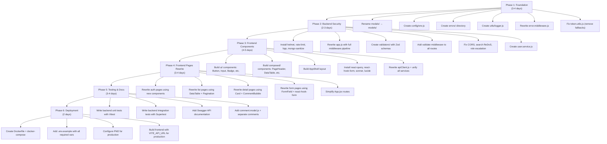

# Customer Care Portal — Rebuild Guide

> A surgical rebuild plan. Not a rewrite from scratch — a restructuring of what exists into production-grade architecture, with every library justified against a real problem in your current codebase.

---

## Table of Contents

1. [Backend: New Folder Structure](#1-backend-new-folder-structure)
2. [Backend: External Libraries Catalog](#2-backend-external-libraries-catalog)
3. [Backend: File-by-File Rebuild Plan](#3-backend-file-by-file-rebuild-plan)
4. [Frontend: Component Architecture](#4-frontend-component-architecture)
5. [Frontend: External Libraries Catalog](#5-frontend-external-libraries-catalog)
6. [Frontend: File-by-File Rebuild Plan](#6-frontend-file-by-file-rebuild-plan)
7. [Shared Concerns](#7-shared-concerns)
8. [Execution Order](#8-execution-order)

---

## 1. Backend: New Folder Structure

Your current structure is functional but flat. Here's what it should become:

```
backend/src/
├── server.js                    # Entry point (KEEP, minor changes)
├── app.js                       # Express app assembly (REWRITE)
│
├── config/
│   ├── db.js                    # MongoDB connection (KEEP, add options)
│   ├── env.js                   # NEW — Centralized env validation
│   ├── permissions.js           # KEEP
│   ├── cors.js                  # NEW — CORS whitelist config
│   └── rateLimiter.js           # NEW — Rate limit presets
│
├── errors/                      # NEW — Typed error classes
│   ├── AppError.js              # Base error with statusCode + errorCode
│   ├── NotFoundError.js         # 404
│   ├── ValidationError.js       # 400
│   ├── UnauthorizedError.js     # 401
│   └── ForbiddenError.js        # 403
│
├── validators/                  # NEW — Zod request schemas
│   ├── auth.validator.js        # register, login, resetPassword schemas
│   ├── customer.validator.js    # create, update customer schemas
│   ├── ticket.validator.js      # create ticket, add comment schemas
│   └── user.validator.js        # create/update employee schemas
│
├── middleware/
│   ├── auth.middleware.js       # REWRITE — Cleaner, use typed errors
│   ├── error.middleware.js      # REWRITE — Use typed error classes
│   ├── validate.middleware.js   # NEW — Generic Zod validation middleware
│   └── requestId.middleware.js  # NEW — Attach unique ID to every request
│
├── models/                      # RENAME from modals/ → models/
│   ├── user.model.js            # RENAME from user.schema.js
│   ├── customer.model.js        # RENAME from customer.schema.js
│   ├── ticket.model.js          # MODIFY — Remove embedded comments array
│   ├── comment.model.js         # NEW — Separate collection for comments
│   └── auditLog.model.js       # NEW — Activity trail
│
├── routes/
│   ├── auth.routes.js           # MODIFY — Add validation middleware
│   ├── customer.routes.js       # MODIFY — Add validation middleware
│   ├── ticket.routes.js         # MODIFY — Add validation middleware
│   └── user.routes.js           # MODIFY — Add validation middleware
│
├── controllers/                 # RENAME from controller/
│   ├── auth.controller.js       # KEEP (minor cleanup)
│   ├── customer.controller.js   # KEEP (minor cleanup)
│   ├── ticket.controller.js     # KEEP (minor cleanup)
│   └── user.controller.js       # REWRITE — Move DB queries to service layer
│
├── services/                    # RENAME from service/
│   ├── auth.service.js          # MODIFY — Use typed errors
│   ├── customer.service.js      # MODIFY — Use typed errors, fix search
│   ├── ticket.service.js        # MODIFY — Use typed errors, separate comments
│   ├── user.service.js          # NEW — Extract from user.controller.js
│   └── email.service.js         # RENAME from utils/email.utils.js
│
├── utils/
│   ├── token.utils.js           # MODIFY — Remove fallback secrets, crash on missing
│   ├── logger.js                # NEW — Pino structured logging
│   └── escapeRegex.js           # NEW — Safe regex escaping for search
│
├── jobs/                        # NEW — Background job definitions (future)
│   └── README.md
│
└── tests/                       # NEW — Test files
    ├── auth.test.js
    ├── customer.test.js
    └── ticket.test.js
```

> [!IMPORTANT]
> **Why `models/` not `modals/`?** This is a critical rename. "Modals" are UI dialog boxes. "Models" are data schemas. Every import in the project references `../modals/`. This typo has propagated through every file. Fixing it now prevents confusion for every future developer who touches this codebase.

---

## 2. Backend: External Libraries Catalog

Every library below solves a **specific, identified problem** in your current codebase. Nothing is added "just because."

### Security Libraries

| Library | npm install | What Problem It Solves in YOUR Code |
|---|---|---|
| **helmet** | `npm i helmet` | Your `app.js` sets zero HTTP security headers. Helmet adds `X-Content-Type-Options`, `Strict-Transport-Security`, `X-Frame-Options`, `Content-Security-Policy`, and more — in one line. Without it, your app is vulnerable to clickjacking, MIME sniffing, and XSS via headers |
| **express-rate-limit** | `npm i express-rate-limit` | Your login, register, forgot-password endpoints have **zero rate limiting**. An attacker can brute-force passwords with unlimited attempts. This library adds per-IP request limits (e.g., 5 login attempts per 15 minutes) |
| **hpp** | `npm i hpp` | HTTP Parameter Pollution protection. If someone sends `?status=open&status=closed`, Express puts both in `req.query.status` as an array, which can break your filters or bypass authorization. `hpp` picks the last value and puts extras in `req.query.polluted` |
| **express-mongo-sanitize** | `npm i express-mongo-sanitize` | Your app passes `req.body` directly to Mongoose queries. A malicious user can send `{"email": {"$gt": ""}}` to bypass filters. This library strips `$` and `.` operators from user input |
| **cors** (configured) | Already installed | Your `app.js` calls `cors()` with **no arguments**, which means **any website can make authenticated requests**. You need to configure it with a whitelist: `cors({ origin: ["http://localhost:5173", "https://yourapp.com"], credentials: true })` |

### Validation

| Library | npm install | What Problem It Solves |
|---|---|---|
| **zod** | `npm i zod` | Your validation is hand-rolled and inconsistent. `customer.validation.js` manually checks fields with `if/throw`. Auth has **no validation at all** — a user can register with `role: "super_admin"`. Zod gives you declarative schemas that validate, transform (trim, lowercase), and type-check in one place. It also generates TypeScript types for free if you ever migrate |

### Logging & Observability

| Library | npm install | What Problem It Solves |
|---|---|---|
| **pino** | `npm i pino` | Your entire backend uses `console.log` and `console.error`. In production, you need structured JSON logs with timestamps, log levels, request IDs, and correlation. Pino is the fastest Node.js logger (5x faster than Winston) and outputs structured JSON that tools like Datadog, ELK, or CloudWatch can parse |
| **pino-pretty** | `npm i -D pino-pretty` | Dev-only. Makes Pino's JSON output human-readable in your terminal during development. Not used in production |
| **uuid** or **crypto.randomUUID** | Built-in (Node 19+) | For generating request IDs. Every HTTP request gets a unique ID attached so you can trace logs across controller → service → database for a single request. Your current code has no way to correlate error logs to specific requests |

### Performance

| Library | npm install | What Problem It Solves |
|---|---|---|
| **compression** | `npm i compression` | Your API responses are sent uncompressed. For list endpoints returning 50+ customers/tickets with nested data, gzip compression can reduce payload size by 60-80%. This is a one-line middleware |

### API Documentation

| Library | npm install | What Problem It Solves |
|---|---|---|
| **swagger-jsdoc** | `npm i swagger-jsdoc` | Your API has **zero documentation**. No other developer (or frontend team) can integrate with your backend without reading source code. swagger-jsdoc lets you write OpenAPI specs as JSDoc comments above each route |
| **swagger-ui-express** | `npm i swagger-ui-express` | Serves a beautiful, interactive API documentation page at `/api-docs`. Frontend developers can test endpoints directly from the browser |

### File Uploads (When Adding Attachments Module)

| Library | npm install | What Problem It Solves |
|---|---|---|
| **multer** | `npm i multer` | Your ticket system has no file attachment support. Multer handles multipart form data (file uploads) for Express. It can store files on disk or pass them as buffers to cloud storage |
| **@aws-sdk/client-s3** or **@google-cloud/storage** | Depends on provider | For storing uploaded files in cloud storage instead of local disk. Local storage doesn't work behind load balancers or in containerized deployments |

### Testing

| Library | npm install | What Problem It Solves |
|---|---|---|
| **vitest** | `npm i -D vitest` | You have **zero tests**. Vitest is the fastest modern test runner, works natively with ES modules (your project uses `"type": "module"`), and has the same API as Jest |
| **supertest** | `npm i -D supertest` | For HTTP-level integration tests. You can test your actual Express routes without starting a server: `const res = await request(app).post("/auth/login").send({...})` |
| **mongodb-memory-server** | `npm i -D mongodb-memory-server` | Spins up an in-memory MongoDB instance for tests. Your tests don't touch your real database. Each test suite gets a fresh, isolated database |

### Process Management (Production)

| Library | npm install | What Problem It Solves |
|---|---|---|
| **pm2** | `npm i -g pm2` | Your `server.js` runs a single Node.js process. If it crashes, it stays dead. PM2 auto-restarts crashed processes, runs multiple instances (cluster mode) to use all CPU cores, and provides log management + monitoring |

### Summary: Backend `package.json` After Rebuild

```json
{
  "dependencies": {
    "bcryptjs": "^3.0.3",
    "compression": "NEW",
    "cors": "^2.8.6",
    "dotenv": "^18.0.1",
    "express": "^5.2.1",
    "express-mongo-sanitize": "NEW",
    "express-rate-limit": "NEW",
    "helmet": "NEW",
    "hpp": "NEW",
    "jsonwebtoken": "^9.0.3",
    "mongoose": "^9.10.1",
    "multer": "NEW (when adding attachments)",
    "nodemailer": "^10.0.10",
    "pino": "NEW",
    "swagger-jsdoc": "NEW",
    "swagger-ui-express": "NEW",
    "zod": "NEW"
  },
  "devDependencies": {
    "@faker-js/faker": "^10.6.0",
    "mongodb-memory-server": "NEW",
    "nodemon": "^3.1.14",
    "pino-pretty": "NEW",
    "supertest": "NEW",
    "vitest": "NEW"
  }
}
```

> Total new production dependencies: **8** (helmet, express-rate-limit, hpp, express-mongo-sanitize, compression, pino, zod, swagger-jsdoc + swagger-ui-express). Every single one addresses a real gap.

---

## 3. Backend: File-by-File Rebuild Plan

### 3.1 — Create `config/env.js` (NEW)

**Purpose:** Validate that ALL required environment variables exist at startup. Crash immediately if any are missing — don't silently fall back to insecure defaults.

**What it replaces:** The dangerous pattern in `token.utils.js`:
```
const ACCESS_SECRET = process.env.JWT_ACCESS_SECRET || "access_secret_fallback_key"
```

**What it does:**
- Reads and validates every env var using Zod
- Exports a frozen `env` object that the rest of the app imports
- If `JWT_ACCESS_SECRET` is missing, the server refuses to start with a clear error message
- Variables to validate: `MONGO_URI`, `JWT_ACCESS_SECRET`, `JWT_REFRESH_SECRET`, `PORT`, `FRONTEND_URL`, `ALLOWED_ORIGINS`, `EMAIL_USER` (optional), `EMAIL_PASS` (optional), `NODE_ENV`

### 3.2 — Create `errors/` Directory (NEW)

**Purpose:** Replace every `throw new Error("...")` in the codebase with typed error classes that carry HTTP status codes and machine-readable error codes.

**Files to create:**
- `AppError.js` — Base class extending `Error`. Properties: `statusCode`, `errorCode`, `isOperational`
- `NotFoundError.js` — Extends AppError, sets `statusCode: 404`
- `ValidationError.js` — Extends AppError, sets `statusCode: 400`, carries a `fieldErrors` object
- `UnauthorizedError.js` — Extends AppError, sets `statusCode: 401`
- `ForbiddenError.js` — Extends AppError, sets `statusCode: 403`

**Impact:** Every service file currently does `throw new Error("Customer not found")`. The error middleware can't distinguish between "customer not found" (404), "invalid input" (400), and "server crashed" (500) — it defaults everything to 400. With typed errors, the middleware automatically maps each error to the correct HTTP status.

### 3.3 — Create `validators/` Directory (NEW)

**Purpose:** Define Zod schemas for every API endpoint's request body.

**Files to create:**

- **`auth.validator.js`** — Schemas for:
  - `registerSchema` — Locks `role` to `"customer"` only (fixes privilege escalation). Validates name (2-60 chars), email (valid format, trimmed, lowercased), password (8+ chars)
  - `loginSchema` — email + password required
  - `forgotPasswordSchema` — email required
  - `resetPasswordSchema` — password (8+ chars)

- **`customer.validator.js`** — Schemas for:
  - `createCustomerSchema` — Replaces your hand-rolled `validateCustomerData()`. Validates firstName, lastName, gender (enum), dob (not in future), addresses (min 1, exactly one primary), communications (min 1, exactly one primary, phone regex per country code)
  - `updateCustomerSchema` — Same but all fields optional (partial update)

- **`ticket.validator.js`** — Schemas for:
  - `createTicketSchema` — title (required, 5-200 chars), description (required, 10-5000 chars), priority (enum)
  - `addCommentSchema` — text (required, 1-2000 chars), isInternal (boolean)
  - `updateStatusSchema` — status (enum of valid values)
  - `assignTicketSchema` — employeeId (valid MongoDB ObjectId format or empty string)

- **`user.validator.js`** — Schemas for:
  - `createEmployeeSchema` — name, email, password, department (enum)
  - `updateEmployeeSchema` — Partial, with permission array validation

### 3.4 — Create `middleware/validate.middleware.js` (NEW)

**Purpose:** A generic middleware factory that validates `req.body` (or `req.query`, `req.params`) against a Zod schema before the request reaches the controller.

**How it's used in routes:**
```
router.post("/", validate(createTicketSchema), requirePermission(...), createTicket)
```

The Zod schema validates, trims, transforms, and rejects bad input BEFORE your controller even runs. If validation fails, it returns a structured 400 error with field-level errors that the frontend can map to form fields.

### 3.5 — Create `middleware/requestId.middleware.js` (NEW)

**Purpose:** Attaches a unique `req.id` (UUID) to every incoming request. This ID is:
- Included in every log entry via Pino
- Returned in the response header `X-Request-Id`
- Used to trace a single request across controller → service → database → error logs

### 3.6 — Rewrite `middleware/error.middleware.js`

**Current problem:** Defaults to `400` for all errors, including genuine server crashes. `console.error(error)` dumps the full stack trace to stdout with no structure.

**After rebuild:**
- If `error instanceof AppError` → use its `statusCode` and `errorCode`
- If Mongoose `ValidationError` → map to 400 with field errors
- If Mongoose `CastError` → map to 400 with "invalid ID" message
- If JWT `TokenExpiredError` or `JsonWebTokenError` → map to 401
- Anything else → 500 Internal Server Error (never leak stack traces to client)
- Log every error with Pino, including `req.id` for correlation
- In development, include stack trace in response. In production, omit it

### 3.7 — Rewrite `middleware/auth.middleware.js`

**Current problem:** Works correctly but uses `throw new Error()` for all failure cases. No distinction between "no token provided" and "token expired" and "user deactivated."

**After rebuild:**
- Use `UnauthorizedError` for missing/invalid tokens
- Use `ForbiddenError` for permission failures
- Remove `ROLE_PERMISSIONS` map from this file — move it to `config/permissions.js` to centralize all permission configuration in one place
- Add `super_admin` check to `getEffectivePermissions` (it's already there, but consolidating makes it cleaner)

### 3.8 — Rewrite `app.js`

**Current state:** 24 lines, missing critical middleware.

**After rebuild, the middleware pipeline becomes:**
1. `requestId` — Attach UUID to every request
2. `helmet()` — Set security headers
3. `cors(corsConfig)` — Configured whitelist from `config/cors.js`
4. `compression()` — Gzip responses
5. `express.json({ limit: '10kb' })` — Body parser with size limit (prevent memory exhaustion attacks)
6. `mongoSanitize()` — Strip NoSQL injection operators
7. `hpp()` — HTTP Parameter Pollution protection
8. Rate limiters — Global limiter (100 req/15min) + auth-specific limiter (5 req/15min on login/register)
9. Pino HTTP request logging
10. Routes
11. Swagger UI at `/api-docs`
12. Error middleware (always last)

### 3.9 — Modify `token.utils.js`

**Change:** Remove fallback secret strings. Import validated env vars from `config/env.js`. If the env var is missing, the app already crashed at startup thanks to the env validation — so no fallback is ever needed here.

### 3.10 — Create `utils/logger.js` (NEW)

**Purpose:** Single Pino logger instance shared across the entire backend. Replace every `console.log`, `console.error`, and `console.warn` with `logger.info()`, `logger.error()`, `logger.warn()`.

**Configuration:**
- In development: Pipe through `pino-pretty` for colored, human-readable output
- In production: Raw JSON output with timestamp, level, message, request ID, error stack

### 3.11 — Create `utils/escapeRegex.js` (NEW)

**Purpose:** Fix the ReDoS vulnerability in `customer.service.js`. Your current search:
```
const searchRegex = new RegExp(search, "i");
```
...passes raw user input into `RegExp`. A malicious regex can freeze your server.

This utility function escapes all special regex characters in user input before passing it to `new RegExp()`. Alternatively, use MongoDB's `$text` index with `$search` for proper full-text search (better for production).

### 3.12 — Create `models/comment.model.js` (NEW) & Modify `ticket.model.js`

**Current problem:** Comments are embedded inside the ticket document as an unbounded array. MongoDB has a 16MB document limit. A busy ticket with hundreds of comments will eventually hit this limit and corrupt the document.

**After rebuild:**
- Remove `comments: [...]` from `ticket.model.js`
- Create `comment.model.js` with: `ticketId` (ref → Ticket, indexed), `userId` (ref → User), `text`, `isInternal`, `timestamps`
- Modify `ticket.service.js` to query comments separately with pagination

### 3.13 — Create `models/auditLog.model.js` (NEW)

**Purpose:** Record every significant action for compliance and debugging.

**Fields:** `action` (enum: "ticket.created", "ticket.status_changed", "ticket.assigned", "customer.created", "employee.deactivated", etc.), `performedBy` (ref → User), `targetType` ("Ticket" | "Customer" | "User"), `targetId`, `changes` (object with `from` and `to` values), `ipAddress`, `timestamp`

### 3.14 — Create `services/user.service.js` (NEW)

**Current problem:** `user.controller.js` directly queries MongoDB with `User.find()` and `Ticket.aggregate()`. Every other domain (auth, customer, ticket) correctly delegates to a service layer, but users/employees bypass it.

**After rebuild:** Extract all database logic from `user.controller.js` into `user.service.js`. The controller should only call service methods and format HTTP responses. This makes the business logic unit-testable.

### 3.15 — Rename `utils/email.utils.js` → `services/email.service.js`

**Why:** Email sending is a service, not a utility. It has external dependencies (SMTP), side effects (sending email), and should be mockable in tests. Moving it to `services/` makes the architecture honest about what it is.

### 3.16 — Add Database Indexes

**Current problem:** No compound indexes defined. As data grows, every query does a full collection scan.

**Indexes to add:**
- `ticket.model.js`: `{ status: 1, createdAt: -1 }`, `{ assignedTo: 1, status: 1 }`, `{ customerId: 1, createdAt: -1 }`
- `customer.model.js`: `{ assignedTo: 1 }`, `{ "communications.email": 1 }`
- `comment.model.js`: `{ ticketId: 1, createdAt: 1 }`
- `auditLog.model.js`: `{ targetType: 1, targetId: 1 }`, `{ performedBy: 1 }`, `{ createdAt: -1 }` with TTL index for auto-cleanup

---

## 4. Frontend: Component Architecture

### The Core Problem

Your React app has **almost zero reusable components**. Here's the evidence:

| Pattern | How Many Times It Appears | Should Be a Component |
|---|---|---|
| Spinner (`border-2 border-blue-600 border-t-transparent rounded-full animate-spin`) | 6+ times across pages | `<Spinner />` |
| Error alert box (`bg-red-50 border border-red-200 text-red-600...`) | 8+ times | `<Alert variant="error" />` |
| Page header (title + subtitle + action buttons) | Every single page | `<PageHeader />` |
| Empty state ("No tickets found" with description) | 4+ times | `<EmptyState />` |
| Form input with label | Every form (Login, Register, CustomerForm, TicketForm, EmployeeForm) | `<FormField />` |
| Status badge (`bg-green-100 text-green-800 border-green-200`) | `getStatusColor()` duplicated in AdminDashboard, TicketListPage, TicketDetailsPage | `<StatusBadge />` |
| Priority indicator | Duplicated in TicketListPage, TicketDetailsPage | `<PriorityBadge />` |
| Pagination (Previous / Page X of Y / Next) | TicketListPage, CustomerListPage | `<Pagination />` |
| Layout (nav + branding + logout + outlet) | 3 nearly identical files (AdminLayout, EmployeeLayout, CustomerLayout) | `<AppShell />` |
| Confirm dialog | Only `DeleteConfirmModal` — but hardcoded to "Delete Customer" | `<ConfirmDialog />` |

### New Component Tree

```
client/src/
├── components/
│   ├── ui/                          # Atomic design primitives
│   │   ├── Button.jsx               # Primary, secondary, danger, ghost, loading variants
│   │   ├── Input.jsx                # Text input with label, error, helper text
│   │   ├── Select.jsx               # Dropdown with label and error state
│   │   ├── Textarea.jsx             # Multi-line input with label
│   │   ├── Badge.jsx                # Status/priority/role badges with variant colors
│   │   ├── Spinner.jsx              # Loading spinner (replaces 6+ inline spinners)
│   │   ├── Skeleton.jsx             # Shimmer loading placeholder
│   │   ├── Alert.jsx                # Error/success/warning/info messages
│   │   ├── Card.jsx                 # Bordered container with optional header
│   │   ├── Modal.jsx                # Generic dialog with backdrop, escape, focus trap
│   │   └── Avatar.jsx               # User initial circle (replaces "A", "E", "C" squares)
│   │
│   ├── composed/                    # Built from ui/ primitives
│   │   ├── PageHeader.jsx           # Title + subtitle + action buttons
│   │   ├── EmptyState.jsx           # Icon + message + optional CTA
│   │   ├── Pagination.jsx           # Page controls (extracted from TicketListPage)
│   │   ├── ConfirmDialog.jsx        # Generic confirm (replaces DeleteConfirmModal)
│   │   ├── DataTable.jsx            # AG Grid wrapper with standard config
│   │   ├── StatusBadge.jsx          # Badge with status-specific colors
│   │   ├── PriorityBadge.jsx        # Badge with priority-specific colors
│   │   ├── FormField.jsx            # Label + Input + error message composition
│   │   └── CommentBubble.jsx        # Chat-style comment (extracted from TicketDetailsPage)
│   │
│   ├── guards/                      # Auth & permission wrappers
│   │   ├── ProtectedRoute.jsx       # KEEP (clean up redirect logic)
│   │   └── HasPermission.jsx        # KEEP (already well-designed)
│   │
│   └── CustomerForm/                # KEEP (already well-decomposed)
│       ├── CustomerForm.jsx
│       ├── BasicInformation.jsx
│       ├── AddressSection.jsx
│       ├── AddressCard.jsx
│       ├── CommunicationSection.jsx
│       ├── CommunicationCard.jsx
│       └── CountryCodeDropdown.jsx
│
├── layouts/
│   └── AppShell.jsx                 # SINGLE layout (replaces 3 duplicate files)
│
├── config/
│   ├── permissions.js               # KEEP
│   ├── navigation.js                # NEW — Role-based nav items config
│   └── routes.js                    # NEW — Centralized route path constants
│
├── hooks/                           # NEW — Custom React hooks
│   ├── useDocumentTitle.js          # Set page <title> dynamically
│   ├── useDebounce.js               # Debounce search input (for customer search)
│   └── usePagination.js             # Pagination state management
│
├── context/
│   ├── AuthContext.jsx              # KEEP (minor cleanup)
│   └── authPermissions.js           # KEEP
│
├── services/                        # REWRITE — Unify API layer
│   └── api.js                       # Single file exporting all API methods
│
├── utils/
│   ├── apiClient.js                 # REWRITE — Cleaner interceptor pattern
│   ├── formatters.js                # NEW — Date, name, currency formatters
│   └── constants.js                 # NEW — Status/priority/department enums
│
├── pages/                           # SIMPLIFY — Pages become thin wrappers
│   ├── auth/
│   │   ├── LoginPage.jsx            # REWRITE using FormField + Button
│   │   ├── RegisterPage.jsx         # REWRITE using FormField + Button
│   │   ├── ForgotPasswordPage.jsx   # REWRITE using FormField + Button
│   │   ├── ResetPasswordPage.jsx    # REWRITE using FormField + Button
│   │   └── VerifyEmailPage.jsx      # SIMPLIFY
│   ├── customers/
│   │   ├── CustomerListPage.jsx     # SIMPLIFY using DataTable + Pagination
│   │   ├── CustomerDetailsPage.jsx  # SIMPLIFY using Card + Badge
│   │   └── CustomerFormPage.jsx     # KEEP (rename from CustomerPage)
│   ├── employees/
│   │   ├── EmployeeListPage.jsx     # SIMPLIFY using DataTable
│   │   ├── EmployeeFormPage.jsx     # REWRITE using FormField
│   │   └── EmployeeDashboard.jsx    # KEEP
│   ├── tickets/
│   │   ├── TicketListPage.jsx       # SIMPLIFY using DataTable + StatusBadge + PriorityBadge
│   │   ├── TicketDetailsPage.jsx    # SIMPLIFY using CommentBubble + Card
│   │   └── TicketFormPage.jsx       # REWRITE using FormField
│   └── admin/
│       └── AdminDashboard.jsx       # SIMPLIFY using Card + StatusBadge
│
├── App.jsx                          # SIMPLIFY — Cleaner route definitions
├── App.css                          # KEEP
├── index.css                        # KEEP
└── main.jsx                         # KEEP
```

### The Single Layout: `AppShell.jsx`

Your three layout files (`AdminLayout.jsx`, `EmployeeLayout.jsx`, `CustomerLayout.jsx`) are **70-80% identical code**. The only differences are:

| Aspect | AdminLayout | EmployeeLayout | CustomerLayout |
|---|---|---|---|
| Background color | `bg-slate-950` | `bg-slate-800` | `bg-white` |
| Branding text | "Admin Portal" | "Employee Portal" | "Customer Care" |
| Branding letter | "A" | "E" | "C" |
| Nav links | 5 links | 4 links | 2 links |
| Notification badge | Open tickets | Unread customers | None |

**Solution:** One `AppShell.jsx` component that takes its configuration from a `navigation.js` config file:

The config file maps each role to its nav items, branding, color scheme, and notification fetch function. The AppShell reads the current user's role and renders accordingly. **One component, zero duplication.**

---

## 5. Frontend: External Libraries Catalog

### Data Fetching & Server State

| Library | npm install | What Problem It Solves in YOUR Code |
|---|---|---|
| **@tanstack/react-query** | `npm i @tanstack/react-query` | Every page manually manages `isLoading`, `error`, `data` state with `useState` + `useEffect` + try/catch. This pattern is duplicated in every single page. React Query eliminates this entirely — gives you automatic caching, background refetching, loading/error states, stale-while-revalidate, and request deduplication. Your 30-line `useEffect` data-fetching blocks become one-line `useQuery` calls. **This is the single highest-impact library you can add** |

### Form Management

| Library | npm install | What Problem It Solves |
|---|---|---|
| **react-hook-form** | `npm i react-hook-form` | Your forms use individual `useState` for every field (`[email, setEmail]`, `[password, setPassword]`, `[showPassword, setShowPassword]`...). LoginPage has 5 state variables just for the form. RegisterPage has even more. CustomerForm.jsx is 13KB of manual state management. React Hook Form manages all form state, validation, dirty tracking, and submission in a declarative way with zero re-renders |
| **@hookform/resolvers** | `npm i @hookform/resolvers` | Bridges React Hook Form with Zod. You define the Zod schema once, and it drives both backend validation AND frontend form validation. Same schema, both sides. No duplication |

### UI Enhancements

| Library | npm install | What Problem It Solves |
|---|---|---|
| **sonner** | `npm i sonner` | Your app uses `alert()` for error messages in `TicketDetailsPage.jsx` (`alert(err.message)`). `alert()` blocks the UI thread and looks unprofessional. Sonner provides beautiful, stackable toast notifications. 2KB, zero dependencies |
| **lucide-react** | `npm i lucide-react` | Your LoginPage has 15+ lines of inline SVG for the eye/eye-off icon. Every icon in the app is either inline SVG or text ("← Back", "→ View"). Lucide gives you 1400+ consistent, tree-shakeable icons as React components: `<Eye />`, `<ArrowLeft />`, `<Ticket />`, etc. |
| **clsx** | `npm i clsx` | Your className strings are long conditional ternaries that are hard to read. `clsx` lets you write: `clsx("base-class", isActive && "active-class", variant === "danger" && "danger-class")`. Tiny utility (230 bytes), huge readability improvement |

### Date Handling

| Library | npm install | What Problem It Solves |
|---|---|---|
| **date-fns** | `npm i date-fns` | You use raw `new Date().toLocaleDateString()` and `toLocaleTimeString()` everywhere. These outputs are inconsistent across browsers and locales. date-fns gives you: `formatDistanceToNow(date)` → "3 hours ago", `format(date, "MMM d, yyyy")` → "Oct 13, 2026". Tree-shakeable, no global state |

### Charts (When Adding Analytics Dashboard)

| Library | npm install | What Problem It Solves |
|---|---|---|
| **recharts** | `npm i recharts` | Your AdminDashboard shows only raw numbers (Total Customers: 42). An MNC dashboard needs charts — tickets over time, resolution time trends, agent performance. Recharts is the most popular React charting library, built on D3 but with a React-native API |

### File Upload (When Adding Attachments)

| Library | npm install | What Problem It Solves |
|---|---|---|
| **react-dropzone** | `npm i react-dropzone` | For drag-and-drop file uploads on ticket creation and comments. Handles file type validation, size limits, and preview generation |

### Summary: Frontend `package.json` After Rebuild

```json
{
  "dependencies": {
    "@hookform/resolvers": "NEW",
    "@tailwindcss/vite": "^4.3.3",
    "@tanstack/react-query": "NEW",
    "ag-grid-community": "^36.2.0",
    "ag-grid-react": "^36.2.0",
    "clsx": "NEW",
    "date-fns": "NEW",
    "lucide-react": "NEW",
    "react": "^19.1.0",
    "react-dom": "^19.1.0",
    "react-hook-form": "NEW",
    "react-router-dom": "^7.18.4",
    "sonner": "NEW",
    "tailwindcss": "^4.3.3",
    "zod": "NEW (shared with backend)"
  }
}
```

> Total new dependencies: **8** (react-query, react-hook-form, hookform/resolvers, sonner, lucide-react, clsx, date-fns, zod). Add recharts and react-dropzone only when you build those features.

---

## 6. Frontend: File-by-File Rebuild Plan

### 6.1 — Create `components/ui/` Directory (NEW)

These are your **design system primitives**. Every UI element in the app should be built from these. The key principle: **a page should never contain raw HTML elements with Tailwind classes for common patterns**. If you see `<button className="px-3 py-1.5 bg-blue-600 text-white..."` in a page file, it means `Button.jsx` is missing a variant.

**Each component should accept:**
- Standard HTML props (spread via `...rest`)
- `className` for override/extension (merged via `clsx`)
- Semantic `variant` prop where applicable

**Components to build:**

| Component | Variants/Props | Replaces |
|---|---|---|
| `Button` | `variant`: primary, secondary, danger, ghost. `size`: sm, md. `isLoading`: shows spinner. `disabled` | Every inline `<button className="...">` across all pages |
| `Input` | `label`, `error`, `helperText`, `type`, `leftIcon`, `rightIcon` | Every `<div><label>...<input>...</div>` block in LoginPage, RegisterPage, EmployeeFormPage, TicketFormPage |
| `Select` | `label`, `error`, `options`, `placeholder` | Every `<select className="...">` in TicketListPage, TicketDetailsPage, EmployeeFormPage |
| `Textarea` | `label`, `error`, `rows` | Comment input in TicketDetailsPage, description in TicketFormPage |
| `Badge` | `variant`: success, warning, danger, info, neutral. `size`: sm, md | `getStatusColor()` and `getPriorityColor()` functions duplicated across files |
| `Spinner` | `size`: sm, md, lg | The `<div className="w-7 h-7 border-2 border-blue-600 border-t-transparent rounded-full animate-spin" />` copy-pasted 6+ times |
| `Skeleton` | `width`, `height`, `rounded` | Replace spinners with shimmer loading states for a professional feel |
| `Alert` | `variant`: error, success, warning, info. `onDismiss` | The `<div className="bg-red-50 border border-red-200 text-red-600...">` copy-pasted 8+ times |
| `Card` | `title`, `headerAction`, `padding` | The `<div className="bg-white border border-gray-200 rounded-lg...">` pattern used everywhere |
| `Modal` | `isOpen`, `onClose`, `title`, `size` | Replace `DeleteConfirmModal` with a generic modal that any content can be placed inside |
| `Avatar` | `name`, `size`, `color` | The branding squares ("A", "E", "C") in layouts, and user initials in comments |

### 6.2 — Create `components/composed/` Directory (NEW)

These combine `ui/` primitives into domain-aware components:

| Component | What It Does |
|---|---|
| `PageHeader` | Renders the title + subtitle + action buttons area at the top of every page. Accepts `title`, `subtitle`, `actions` (array of Button configs) |
| `EmptyState` | Icon + title + message + optional CTA button. Used when ticket/customer lists are empty |
| `Pagination` | Previous/Next buttons + "Page X of Y". Extracted from the duplicated code in TicketListPage and CustomerListPage |
| `ConfirmDialog` | Generic confirmation modal. Accepts `title`, `message`, `confirmLabel`, `variant` (danger, warning), `onConfirm`, `onCancel`, `isLoading`. Replaces `DeleteConfirmModal` which is hardcoded to "Delete Customer" |
| `DataTable` | Wraps AG Grid with your standard defaults (`sortable`, `filter`, `resizable`, theme). Handles the loading/empty states internally. Every list page becomes: `<DataTable columns={cols} data={data} isLoading={loading} emptyMessage="No tickets found" />` |
| `StatusBadge` | `<Badge>` pre-configured with status → color mapping. Eliminates the `getStatusColor()` function duplicated in 3 files |
| `PriorityBadge` | Same pattern for priority → color mapping |
| `FormField` | Composes `<Input>` (or `<Select>`, `<Textarea>`) with label, error message, and React Hook Form registration. One component handles the entire labeled-input-with-error pattern |
| `CommentBubble` | The chat bubble UI from TicketDetailsPage. Accepts `comment`, `isOwnMessage`, `isInternal`. Currently this is 20 lines of JSX duplicated inline |

### 6.3 — Create `layouts/AppShell.jsx` (Replaces 3 Files)

**Delete:** `AdminLayout.jsx`, `EmployeeLayout.jsx`, `CustomerLayout.jsx`
**Create:** `AppShell.jsx` + `config/navigation.js`

The `navigation.js` config file defines, per role:
- `branding`: object with `label` and `letter`
- `theme`: object with `navBg`, `textColor`, `activeColor`
- `navItems`: array of `{ to, label, permission, notificationKey }`
- `notificationFetchers`: object mapping notification keys to API functions

AppShell reads `user.role` from AuthContext, looks up the config, and renders the nav bar, branding, notification badges, user info, logout button, and `<Outlet />`.

### 6.4 — Rewrite `services/` and `utils/apiClient.js`

**Current problems:**
1. `authAPI.js` uses raw `fetch()` with hardcoded `http://localhost:3000/auth`. It bypasses your `apiClient.js` entirely — meaning token refresh doesn't work for auth calls
2. `customerAPI.js`, `ticketAPI.js`, `userAPI.js` use `apiClient.js` — inconsistent
3. `apiClient.js` hardcodes `http://localhost:3000` — breaks in production

**After rebuild:**

- `apiClient.js` becomes a cleaner HTTP client:
  - Reads `VITE_API_URL` from env (no hardcoded localhost)
  - Exports `api.get()`, `api.post()`, `api.put()`, `api.patch()`, `api.delete()`
  - Token refresh logic stays (it's well-implemented), but cleaner
  - Every API call in the app goes through this client

- All service files are consolidated or updated to use `apiClient`:
  - `authAPI.js` — Rewrite to use `apiClient` instead of raw `fetch`
  - Other files — Change from `await apiClient(url)` + `await response.json()` + `if (!response.ok)` to the cleaner `api.post(url, body)` which handles all of that internally

### 6.5 — Create `config/navigation.js` (NEW)

Role-to-nav-items mapping. Single source of truth for what each role sees in the navigation bar, what badge notifications they get, and what actions are available.

### 6.6 — Create `config/routes.js` (NEW)

**Current problem:** Route paths are hardcoded strings scattered across `App.jsx`, every layout, every `<Link to="...">`, and every `navigate("...")` call. If you rename `/admin/support` to `/admin/tickets`, you have to find-and-replace across 10+ files.

**After rebuild:** Export a `ROUTES` object:
```
ROUTES.admin.support → "/admin/support"
ROUTES.admin.customerDetails(id) → "/admin/customers/${id}"
```
Every `<Link>` and `navigate()` references `ROUTES` instead of string literals.

### 6.7 — Create `hooks/` Directory (NEW)

| Hook | What It Does |
|---|---|
| `useDocumentTitle(title)` | Sets `document.title` on mount. Currently no page sets the browser tab title — they all show "Vite + React" |
| `useDebounce(value, delay)` | Returns a debounced version of a value. Used for the customer search input — currently every keystroke fires an API call |
| `usePagination(fetchFn, options)` | Encapsulates `page`, `totalPages`, `setPage`, `goNext`, `goPrev` state. Currently duplicated in TicketListPage and CustomerListPage |

### 6.8 — Create `utils/formatters.js` (NEW)

Centralized formatting functions:
- `formatDate(date)` → "Oct 13, 2026" (using date-fns)
- `formatDateTime(date)` → "Oct 13, 2026, 10:30 PM"
- `formatRelativeTime(date)` → "3 hours ago"
- `formatFullName(firstName, lastName)` → "John Doe"
- `truncate(str, maxLength)` → "This is a long..."

### 6.9 — Create `utils/constants.js` (NEW)

**Current problem:** Status values ("open", "in-progress", "resolved", "closed"), priority values ("low", "medium", "high", "urgent"), and department values ("Sales", "Billing", "HR", "Network", "Management") are hardcoded as strings in JSX across multiple files.

**After rebuild:** Export enum-like objects:
```
TICKET_STATUSES, TICKET_PRIORITIES, DEPARTMENTS
```
Each with `value`, `label`, and `color` for the Badge component. Used in selects, filters, and display.

### 6.10 — Simplify Page Components

After building the reusable component library, every page file becomes **dramatically shorter**. Here's the size reduction expected:

| Page | Current Size | Expected After | Reduction |
|---|---|---|---|
| `LoginPage.jsx` | 148 lines | ~40 lines | 73% |
| `RegisterPage.jsx` | ~200 lines | ~60 lines | 70% |
| `TicketListPage.jsx` | 317 lines | ~80 lines | 75% |
| `TicketDetailsPage.jsx` | 303 lines | ~120 lines | 60% |
| `AdminDashboard.jsx` | 189 lines | ~80 lines | 58% |
| `CustomerDetailsPage.jsx` | ~400 lines | ~150 lines | 63% |
| Layouts (3 files, ~270 lines total) | 270 lines | ~60 lines (1 file) | 78% |

The pages become **thin orchestrators**: they call hooks for data, pass it to composed components, and handle navigation. All UI is in the component library.

---

## 7. Shared Concerns

### 7.1 — Environment Variables Strategy

| Variable | Where | Purpose |
|---|---|---|
| `VITE_API_URL` | Frontend `.env` | Base URL for backend API (replaces hardcoded `localhost:3000`) |
| `MONGO_URI` | Backend `.env` | MongoDB connection string |
| `JWT_ACCESS_SECRET` | Backend `.env` | Access token signing key (NO FALLBACK) |
| `JWT_REFRESH_SECRET` | Backend `.env` | Refresh token signing key (NO FALLBACK) |
| `ALLOWED_ORIGINS` | Backend `.env` | Comma-separated CORS whitelist |
| `FRONTEND_URL` | Backend `.env` | For email links (password reset, verification) |
| `NODE_ENV` | Both | "development" or "production" |
| `LOG_LEVEL` | Backend `.env` | Pino log level (debug/info/warn/error) |

### 7.2 — Permission Constants Sharing

Currently, permissions are defined in two places:
- Backend: `config/permissions.js`
- Frontend: `config/permissions.js` (duplicated)

These MUST stay in sync. Options:
1. **Manual sync** (current approach) — Accept it, but add a comment in both files linking to the other
2. **Shared constants package** — If you ever move to a monorepo (Turborepo/Nx), extract permissions into a `@portal/shared` package imported by both

### 7.3 — Consistent Error Shape

Backend error responses should always follow this shape:
```json
{
  "success": false,
  "errorCode": "TICKET_NOT_FOUND",
  "message": "Ticket not found",
  "fieldErrors": {             
    "email": "Invalid email format",
    "password": "Must be at least 8 characters"
  }
}
```
Frontend can then:
- Show `message` as a toast notification
- Map `fieldErrors` to form field error messages
- Use `errorCode` for conditional logic (e.g., redirect to login on `SESSION_EXPIRED`)

---

## 8. Execution Order

> [!IMPORTANT]
> Do NOT try to do all of this at once. Each phase should be a working, deployable state.



### Phase 1 should be done first because:
- Renaming `modals/` → `models/` touches every import — do it before adding new files
- The error classes and logger are used by everything else
- `config/env.js` prevents the app from running with insecure defaults

### Phase 3 should come before Phase 4 because:
- You need the component library to exist before you can rewrite pages to use it
- Building components in isolation (without page context) forces you to make them truly reusable

> [!TIP]
> **Commit after each sub-step, not after each phase.** If `P1A` (rename modals/) works, commit it. If `P1B` (env validation) works, commit it. Small, atomic commits make it easy to revert if something breaks.

---

## Quick Reference: All Libraries at a Glance

### Backend (13 new packages)

| Package | Category | Size Impact |
|---|---|---|
| `helmet` | Security | ~15KB |
| `express-rate-limit` | Security | ~8KB |
| `hpp` | Security | ~5KB |
| `express-mongo-sanitize` | Security | ~3KB |
| `compression` | Performance | ~10KB |
| `pino` | Logging | ~20KB |
| `pino-pretty` (dev) | Logging | Dev only |
| `zod` | Validation | ~50KB (tree-shakeable) |
| `swagger-jsdoc` | Documentation | ~30KB |
| `swagger-ui-express` | Documentation | ~1MB (static assets) |
| `vitest` (dev) | Testing | Dev only |
| `supertest` (dev) | Testing | Dev only |
| `mongodb-memory-server` (dev) | Testing | Dev only |

### Frontend (8 new packages)

| Package | Category | Size Impact |
|---|---|---|
| `@tanstack/react-query` | Data fetching | ~40KB |
| `react-hook-form` | Forms | ~25KB |
| `@hookform/resolvers` | Forms | ~5KB |
| `zod` | Validation (shared) | ~50KB |
| `sonner` | Toast notifications | ~2KB |
| `lucide-react` | Icons | Tree-shaken, ~1KB per icon |
| `clsx` | Class utilities | ~230 bytes |
| `date-fns` | Date formatting | Tree-shaken, ~2KB per function |

> **Total added bundle size (production, minified+gzipped):** ~45KB frontend, ~45KB backend. This is negligible for the value delivered.
